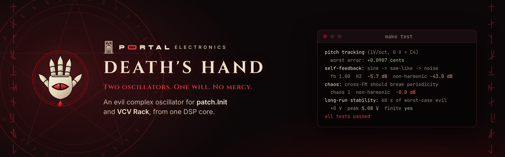
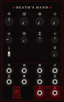
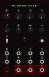

<p align="center">
  
</p>

<p align="center">
  <a href="https://github.com/rossedman/deaths-hand/actions/workflows/ci.yml"></a>
  <a href="https://github.com/rossedman/deaths-hand/releases/latest"></a>
  <a href="LICENSE"></a>
  <a href="https://rossedman.io/deaths-hand/"></a>
</p>

# Death's Hand

**[Listen to it →](https://rossedman.io/deaths-hand/listen/)** Fourteen renders from the same DSP the module runs.

An evil West-Coast style complex oscillator for the Electrosmith patch.Init and VCV Rack — two oscillators where the modulator
shapes the primary through **through-zero FM**, a **wavefolder** (timbre +
symmetry), and **AM / ring mod** — plus three ways to make it misbehave:
**self-feedback**, **chaos** (the primary FMs the modulator back) and a
**Lorenz-attractor modulator**, and a unison stack of up to four drifting
voices and a sub. Three **character macros** play all of it from the front
panel: **FLESH**, **MALICE** and **LEGION**. One portable DSP core, three targets:

```
dsp/      portable engine — no heap, no platform headers, volts in / volts out
hw/       Electrosmith patch.Init() firmware (libDaisy)
vcv/      VCV Rack 2 plugin
test/     host tests, WAV renders, aliasing analysis
```

```
     ┌──────── chaos: primary FMs the modulator back ◄─────┐
     ▼                                                      │
modulator ──┬───────────────────────────────────────► MOD OUT
(sine/tri/  │ linear through-zero FM                        │
 saw/sq/    ├──► primary (sine core) ◄── self-feedback PM ──┤
 Lorenz)    │        │ ─────────────────────────────────────┘
            ├──► timbre mod ─► wavefolder (timbre, symmetry; exact DC removal)
            │                    │
            └──► AM / ring ─────►× ─► 4× decimator ─► OUT
```

Everything runs 4× oversampled and is decimated with a 129-tap Kaiser FIR.

**Its companion, [Doombringer](#doombringer)**, is a ladder filter that summons what isn't there: in the same plugin, on the same patch.Init, from the same DSP core.

## Reading the panel



There are no words on the panel, only sigils. The top row is the voice: pitch
and the three character macros. Below them are the settings the patch.Init
keeps on its shift layer. Each sigil repeats on the jack that modulates it, so
the panel reads in columns.

| Sigil | Means |
|---|---|
| Eye (lashes) | Pitch · V/OCT input |
| Zigzag in a circle | **FLESH** macro · its CV |
| Eight-arrow star | **MALICE** macro · its CV |
| Four rings | **LEGION** macro · its CV |
| Vesica (two rings) | Ratio, or modulator pitch when free |
| Triangle in a circle | Modulator shape. The red last stop is Lorenz |
| Hourglass | Symmetry trim · its CV |
| Slit eye | Fine tune |
| Key | Ratio lock. The red arrow is up = locked |
| Crossed ring ⊗ | Routing: FM, + timbre mod, + AM, + ring · its trigger input |
| Spiral | External FM input |
| Pillars and lightning | Sync input |
| Blood drop (solid) | Primary out |
| Blood drop with rings | Modulator out |

Bone rings mark inputs, red rings mark outputs, and the outputs sit on the
altar. The hand, the edge runes and the summoning circle are decoration.

## The macros

Each macro sweeps several parameters at once, each over its own stretch of
the knob, so one knob (or one CV) tells one story. +/-5 V at a macro's jack
sweeps its whole range, so an envelope into FLESH opens the whole voice.

| Macro | Sweeps | Along the knob |
|---|---|---|
| **FLESH** | FM index, wavefold, symmetry, modulator → timbre | FM sidebands first, then the fold opens (glassy, then snarling), then asymmetry and a moving fold |
| **MALICE** | self-feedback, chaos, extra FM | The lower half is feedback only: sine to saw, still harmonic. The edge into chaos runs from about 0.55 to 0.8. The top is possessed |
| **LEGION** | sub, voices, spread, drift | The sub arrives first, then detuned voices fade in one by one, then they drift apart |

The host tests hold each macro to its story: FLESH's brightness climbs at every
step (220 Hz → 6.8 kHz centroid), MALICE stays harmonic to halfway and is fully
inharmonic by 0.9, and LEGION's beating grows from 2.8× to 4.8×. The curves
live in `dsp/Macros.hpp`.

## Measured (host tests)

| | |
|---|---|
| 1V/oct tracking, −3 V … +5 V | worst error 0.09 cents |
| Alias energy, heavy fold @ 2.96 kHz | −9 dB → **−84 dB** with 4× |
| Alias energy, FM index 1.0 @ C7 | −40 dB → **−84 dB** with 4× |
| Self-feedback 0 → 0.5 → 1 | pure sine (H2 −117 dB) → saw-like (H2 −10 dB) → noisy |
| 60 s worst-case evil (fb, chaos, Lorenz, all max) | finite, alive, no DC lock-up, at 4 pitches |
| Output range | ±5 V nominal, DC-free; heavy feedback/chaos peaks are soft-capped at 7.2 V |
| FLESH 0 → 1: spectral centroid | 220 Hz → 6.8 kHz, rising at every step |
| MALICE: inharmonic share at 0.5 / 0.8 / 0.9 | 0.00 / 0.97 / 1.00 |
| LEGION 0.4 → 1: beating | 2.8× → 4.8× |
| Unison: 4 voices, no spread vs 1 voice | identical to within 0.05 mV |
| Unison: 4 voices spread, biased fold | beat-rate wobble 0.05 V (0.26 V without the envelope-aware DC fix) |
| patch.Init flash / RAM | 106 KB of 128 KB / 36 KB (arm-gcc 13.3) |

## Doombringer



A four-pole ladder filter with something extra. The loop is solved with no
sample of delay, so it self-oscillates in tune (0.06 cents, 33 Hz to 8 kHz)
and plays as an oscillator, and a morph knob moves through LP4, LP2, BP, HP2
and HP4. Three macros sit on the front panel, like Death's Hand's:

| Macro | Does |
|---|---|
| **WRATH** | Resonance and drive: clean, then ringing, then past 0.64 it screams on its own, then the input squares off |
| **RUIN** | Corrupts the resonance: the feedback folds, the output's level bends the cutoff (pinged hits fall in pitch), then the loop is pushed past the knob and breaks free of a quiet input |
| **DOOM** | Undertones: squares an octave and two below the input's pitch, following its envelope, then lurching the cutoff |

On the shift layer: morph, FM depth, **HUNGER** (the input's envelope opens
or closes the cutoff) and fine tune. A button tap or Gate 1 **pings** it: a
half-cycle at the cutoff that rings at the same level at any pitch, so with
no input it is a drum. OUT L is the morph, OUT R the four-pole low-pass, and
CV OUT 1 the input's envelope.

The full guide, with the panel decoder, the control map, five patches and
the measurements, is [in the docs](https://rossedman.io/deaths-hand/doombringer/).
The engine is `dsp/Doombringer.hpp`, the firmware `hw/doombringer.cpp`, and
the tests `test/doom_tests.cpp`.

<br clear="right">

## Flash your patch.Init

### Fastest: prebuilt binary
1. Download `deaths-hand.bin` (or `doombringer.bin`) from the [latest release](https://github.com/rossedman/deaths-hand/releases/latest).
   Every asset is signed; see [Verifying releases](SECURITY.md#verifying-releases).
2. Put the Patch SM into its bootloader: hold **BOOT**, tap **RESET**, release BOOT
   (both buttons are on the Patch SM board on the back of the module).
3. Open Electrosmith's **Daisy Web Programmer** in Chrome (it uses WebUSB), connect
   the module over USB, choose the `.bin` and flash.

### From source (macOS)
```sh
brew install --cask gcc-arm-embedded
brew install dfu-util
git submodule update --init --recursive     # pulls lib/libDaisy
make -C lib/libDaisy                        # once
make -C hw                                  # → hw/build/deaths-hand.bin
make -C hw APP=doombringer                  # → hw/build/doombringer.bin
make -C hw program-dfu                      # after BOOT + RESET (add APP=doombringer for the filter)
```

`make -C hw CPU_METER=1` (with or without `APP=doombringer`) builds a variant that prints DSP load once a second over
USB serial (`screen /dev/tty.usbmodem* 115200`). That's the number to watch as
the engine grows.

## patch.Init control map

Each knob has two jobs. **Hold the button** to reach the shift layer. A
parameter only moves once its knob passes through the stored value (soft
takeover), so switching layers never makes the sound jump.

| Knob | Front | Hold button (shift) |
|---|---|---|
| 1 (CV_1) + jack CV_5 | Pitch, 6 octaves around C4. Jack is 1V/oct | **Ratio**, 11 steps (0.25, 0.5, 1, 1.5, 2, 3 … 8). With the toggle down: free modulator pitch, ~1 Hz LFO up to C7 |
| 2 (CV_2) + jack CV_6 | **FLESH** | **Modulator shape**: sine, triangle, saw, square, Lorenz (5 zones) |
| 3 (CV_3) + jack CV_7 | **MALICE** | **Symmetry** trim (noon = none), added to FLESH's |
| 4 (CV_4) + jack CV_8 | **LEGION** | **Fine tune**, ±1 semitone (noon = in tune) |

Jacks always drive the front-panel parameter: ±5 V sweeps a macro's whole range.

| Other | Does |
|---|---|
| Button tap | Next routing: FM → FM + timbre mod → FM + AM → FM + ring (LED gets brighter each step) |
| Toggle | Up = ratio-locked modulator, down = free |
| Audio IN L | External FM, audio rate, summed with the modulator |
| Audio IN R | Symmetry CV (±5 V), added to the trim |
| Gate 1 / Gate 2 | Hard sync / next routing |
| Audio OUT L / R | Primary / modulator |
| CV OUT 1 | Modulator as 0–5 V CV (an LFO in free mode, a chaotic one with Lorenz) |
| CV OUT 2 / LED | Routing brightness; full while shift is held |

## Six evil patches

Rendered in `test/out/ex*.wav` by the same engine and the same panel mapping
the firmware runs. Knob positions are clock faces: 7:00 is fully
counter-clockwise, 12:00 is centre, 5:00 is fully clockwise. "S1"–"S4" means
hold the button and turn knob 1–4. Routing is the number of taps after
power-on. Untouched shift knobs stay at their defaults: ratio 1:1, sine,
symmetry and fine at noon.

**1 · Reactor hum.** A low drone whose feedback breathes in and out.
Toggle up, routing 0. Pitch 8:40, FLESH 10:30, LEGION 8:10, S1 8:20 (ratio ½),
S3 1:30. Rock **MALICE slowly between 8:00 and 12:00**.

**2 · Lorenz growl.** A chaotic modulator in audio range, like an engine that
won't idle. **Toggle down**, routing 1. Pitch 9:30, S1 1:10, S2 4:00 (Lorenz).
Ease **FLESH from 11:00 to 1:00**.

**3 · Chaos bells.** Inharmonic struck metal that gets more unhinged as it goes.
Toggle up, routing 2. Pitch 12:00, FLESH 7:30, S1 12:00 (ratio 3). Sequencer
into **CV_5**, a fast decaying envelope (0–2.5 V) into **CV_6** (FLESH),
trigger both together. Turn **MALICE from 11:30 to 3:30**.

**4 · Feedback scream.** The pitch dives while feedback tears into noise.
Toggle up, routing 0. FLESH 1:00, S1 10:10 (ratio 1.5), S3 10:00. Together,
sweep **pitch from 4:10 to 9:30** and **MALICE from 12:00 to 5:00**.

**5 · Possession.** Everything rising, then the modulator turns chaotic.
Toggle up, routing 3. Pitch 10:20, LEGION 10:00, S1 11:05 (ratio 2), S2 2:00
(square), S3 2:30. Sweep **FLESH from 11:30 to 4:00** and **MALICE from 9:30
to 3:30**, then **flip S2 to 4:00** (Lorenz) halfway.

**6 · Legion.** One voice becomes a swarm while the fold opens. Toggle up,
routing 0. Pitch 8:40, MALICE 9:00. Sweep **LEGION from 8:30 to 5:00** and
**FLESH from 10:00 to 1:00**.

### Things to verify on your unit (top of `hw/main.cpp`)
- `kAudioFullScaleV`: the volts a full-scale codec sample produces. It's set
  conservatively, so if the output is quiet, measure it and lower the number.
- `kInvertAudio`: the Patch SM's audio stages invert polarity. It doesn't matter
  for tones, but it does for a ramp used as CV.
- `kPitchCvScale` / `kPitchCvOffset`: 1V/oct trim. Send exactly 1 V and 3 V into
  CV_5 and use libDaisy's `VoctCalibration` to get the two numbers.
- Toggle direction: if "up" turns out to be free mode, flip `ps.ratioLock`.

## Host tests
```sh
make -C test analyze    # tests + renders + spectrograms (needs numpy/scipy/matplotlib)
```
Writes `test/out/*.wav` (including `demo.wav`, the six `ex*.wav` patches,
the feedback/chaos sweeps and Doombringer's `doom_*.wav`) and `test/out/aliasing.png`. The suite checks pitch
accuracy, stability under abusive parameters and external FM, through-zero
behaviour, the feedback spectrum, that chaos actually breaks periodicity,
Lorenz boundedness from 0.01 Hz to 20 kHz, 60-second worst-case runs, the
shift-layer pickup logic, and output bounds. Doombringer's suite checks its
five responses against the analog shapes, self-oscillation tracking and level,
bass compensation, ping, drive, the undertones, HUNGER, RUIN, its macros, and
60-second runs with everything at full.

## VCV Rack

The plugin holds both modules, Death's Hand and Doombringer. Each mirrors its
patch.Init program. Death's Hand has the same four front knobs, the shift-layer
settings as their own knobs, a routing knob with a trigger input, and the same
jacks. Doombringer has the cutoff and its macros on top, its shift-layer settings
below, a ping button and the same jacks. Knobs and CVs go through the same
`cosc::panelToParams` and `doom::panelToParams` as the firmware, so a patch
translates one-to-one.

Each release has signed packages for Linux x64, Windows x64, macOS x64 and
macOS arm64. To build one yourself:

```sh
scripts/fetch-rack-sdk.sh ../Rack-SDK lin-x64   # or win-x64, mac-x64, mac-arm64
make -C vcv RACK_DIR=../../Rack-SDK install
```
The panels are generated: `make panel` writes `res/ComplexOsc.svg`,
`res/panel-preview.svg` (with stand-in knobs and jacks) and `src/PanelLayout.hpp` from one table, and
Doombringer's `res/Doombringer.svg`, `res/doombringer-preview.svg` and `src/DoombringerLayout.hpp` from another,
so the widget positions can't drift from the artwork. Every sigil is drawn from code (no
fonts or images), so it renders in Rack and scales cleanly to a printed panel. Both use real Eurorack dimensions
(16 HP × 128.5 mm), so they're also a starting point for physical panels.

## Design notes
- **Wavefolder DC:** symmetry biases a sine folder, which creates DC. A
  high-pass alone re-centres the wave and pushes peaks to about ±8 V. Because
  the core is a sine, the DC is exactly `sin(a·b)·J0(a)`, so it's subtracted
  analytically (a small J0 table), with no limiter and no added aliasing.
- **Through-zero FM:** the primary phase increment is allowed to go negative.
  The phasor wraps in both directions.
- **Self-feedback** is phase modulation by the primary's own output, averaged
  over the last two samples (the DX7 trick). Without the average, feedback
  "hunts" at Nyquist and turns to hiss far too early.
- **Chaos** feeds the primary's output into the modulator's frequency, clamped
  to ±20 kHz so heavy settings can't push it far past the band limit.
- **Unison** stacks up to four primary voices before the wavefolder, so the
  fold intermodulates them (the growl a single voice can't make). Every voice
  gets the same through-zero FM and its own self-feedback history. An idle
  voice shadows voice 0, so it fades in exactly in phase and only spread or
  drift pull it away; with no spread, four voices sound like one. Detuned
  sines this close look like one sine with a beating amplitude A, so the
  folder's DC becomes `sin(a·b)·J0(a·A)`, with A tracked per sample from the
  voices' phasors; that keeps the beat from leaking through as a slow wobble.
- **Macros** are piecewise-linear curves in `dsp/Macros.hpp`, applied by
  `dsp/Panel.hpp`, the one mapping from panel to engine that the firmware,
  the plugin and the patch renders all share. MALICE brings in a little FM of
  its own because chaos only reaches the primary through FM; without it, MALICE
  alone would stop at a saw. Chaos is a tipping point, so its curve is
  stretched to put the edge across 0.55–0.8 of the knob rather than one 5% step.
- **Lorenz** is integrated with a midpoint (RK2) step capped at 0.02, with a
  reset guard, so no setting can make it run away or produce NaN.
- **CPU:** cost is dominated by two 129-tap decimators. If the CPU meter says
  you need headroom, cascaded half-band filters are the next optimization.

## Contributing

Bug reports, DSP fixes, tests and new ways to misbehave are welcome. Read [CONTRIBUTING.md](CONTRIBUTING.md) first; `make check` runs the lint, host tests and panel check that CI runs. This project follows the [Contributor Covenant](CODE_OF_CONDUCT.md). Report security problems privately, as described in [SECURITY.md](SECURITY.md).

## License

[MIT](LICENSE) © 2026 Ross Edman. The vendored fonts in `docs/assets/` are under the SIL Open Font License.
