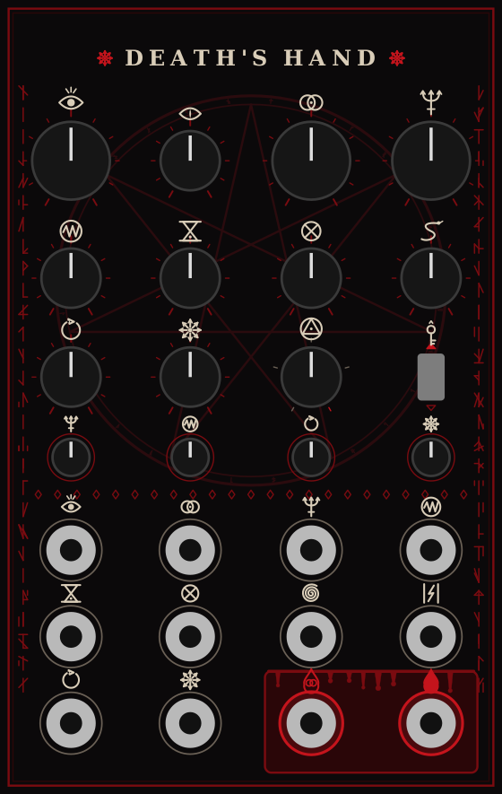

<p align="center">
  
</p>

<p align="center">
  <a href="https://github.com/rossedman/deaths-hand/actions/workflows/ci.yml"></a>
  <a href="https://github.com/rossedman/deaths-hand/releases/latest"></a>
  <a href="LICENSE"></a>
  <a href="https://rossedman.io/deaths-hand/"></a>
</p>

# Death's Hand

An evil West-Coast style complex oscillator for the Electrosmith patch.Init and VCV Rack — two oscillators where the modulator
shapes the primary through **through-zero FM**, a **wavefolder** (timbre +
symmetry), and **AM / ring mod** — plus three ways to make it misbehave:
**self-feedback**, **chaos** (the primary FMs the modulator back) and a
**Lorenz-attractor modulator**. One portable DSP core, three targets:

```
dsp/      portable engine — no heap, no platform headers, volts in / volts out
hw/       Electrosmith patch.Init() firmware (libDaisy)
vcv/      VCV Rack 2 plugin
test/     host tests, WAV renders, aliasing analysis
```

```
     ┌──────── chaos: primary FMs the modulator back ◄─────┐
     ▼                                                      │
modulator ──┬───────────────────────────────────────► MOD OUT
(sine/tri/  │ linear through-zero FM                        │
 saw/sq/    ├──► primary (sine core) ◄── self-feedback PM ──┤
 Lorenz)    │        │ ─────────────────────────────────────┘
            ├──► timbre mod ─► wavefolder (timbre, symmetry; exact DC removal)
            │                    │
            └──► AM / ring ─────►× ─► 4× decimator ─► OUT
```

Everything runs 4× oversampled and is decimated with a 129-tap Kaiser FIR.

## Reading the panel



There are no words on the panel, only sigils. Each knob's sigil is repeated on
the jack and the attenuverter that modulate it, so the panel reads in columns.

| Sigil | Means |
|---|---|
| Eye (lashes) | Pitch · V/OCT input |
| Slit eye | Fine tune |
| Vesica (two rings) | Ratio / modulator pitch · MOD V/OCT input |
| Trident | FM index · its CV and attenuverter |
| Zigzag in a circle | Timbre (fold) · its CV and attenuverter |
| Hourglass | Symmetry · its CV |
| Crossed ring ⊗ | AM → ring mod · its CV |
| Serpent | Modulator → timbre |
| Ouroboros | Self-feedback · its CV and attenuverter |
| Eight-arrow star | Chaos · its CV and attenuverter |
| Triangle in a circle | Modulator shape. The red last stop is Lorenz |
| Key | Ratio lock. The red arrow is up = locked |
| Spiral | External FM input |
| Pillars and lightning | Sync input |
| Blood drop (solid) | Primary out |
| Blood drop with rings | Modulator out |

Bone rings mark inputs, red rings mark outputs, and the outputs sit on the
altar. The edge runes and the summoning circle are decoration.

## Measured (host tests)

| | |
|---|---|
| 1V/oct tracking, −3 V … +5 V | worst error 0.09 cents |
| Alias energy, heavy fold @ 2.96 kHz | −9 dB → **−84 dB** with 4× |
| Alias energy, FM index 1.0 @ C7 | −40 dB → **−84 dB** with 4× |
| Self-feedback 0 → 0.5 → 1 | pure sine (H2 −117 dB) → saw-like (H2 −10 dB) → noisy |
| 60 s worst-case evil (fb, chaos, Lorenz, all max) | finite, alive, no DC lock-up, at 4 pitches |
| Output range | ±5 V nominal, DC-free, peaks up to ~7.3 V with heavy feedback/chaos |
| patch.Init flash / RAM | 106 KB of 128 KB / 37 KB |

## Flash your patch.Init

### Fastest: prebuilt binary
1. Download `deaths-hand.bin` from the [latest release](https://github.com/rossedman/deaths-hand/releases/latest).
   Every asset is signed; see [Verifying releases](SECURITY.md#verifying-releases).
2. Put the Patch SM into its bootloader: hold **BOOT**, tap **RESET**, release BOOT
   (both buttons are on the Patch SM board on the back of the module).
3. Open Electrosmith's **Daisy Web Programmer** in Chrome (it uses WebUSB), connect
   the module over USB, choose `deaths-hand.bin` and flash.

### From source (macOS)
```sh
brew install --cask gcc-arm-embedded
brew install dfu-util
git submodule update --init --recursive     # pulls lib/libDaisy
make -C lib/libDaisy                        # once
make -C hw                                  # → hw/build/deaths-hand.bin
make -C hw program-dfu                      # after BOOT + RESET
```

`make -C hw CPU_METER=1` builds a variant that prints DSP load once a second over
USB serial (`screen /dev/tty.usbmodem* 115200`). That's the number to watch as
the engine grows.

## patch.Init control map

Each knob has two jobs. **Hold the button** to reach the shift layer. A
parameter only moves once its knob passes through the stored value (soft
takeover), so switching layers never makes the sound jump.

| Knob | Normal | Hold button (shift) |
|---|---|---|
| 1 (CV_1) + jack CV_5 | Pitch, 6 octaves around C4. Jack is 1V/oct | **Feedback**: sine → saw → noise |
| 2 (CV_2) + jack CV_8 | **Toggle up:** FM ratio, 11 steps (0.25, 0.5, 1, 1.5, 2, 3 … 8). **Toggle down:** free modulator pitch, ~1 Hz LFO up to C7 | **Chaos**: primary FMs the modulator back |
| 3 (CV_3) + jack CV_6 | FM index | **Symmetry** (noon = none) |
| 4 (CV_4) + jack CV_7 | Timbre (wavefold) | **Modulator shape**: sine, triangle, saw, square, Lorenz (5 zones) |

Jacks always drive the normal-layer parameter.

| Other | Does |
|---|---|
| Button tap | Next routing: FM → FM + timbre mod → FM + AM → FM + ring (LED gets brighter each step) |
| Toggle | Up = ratio-locked modulator, down = free |
| Audio IN L | External FM, audio rate, summed with the modulator |
| Audio IN R | Symmetry CV (±5 V), added to shift-knob 3 |
| Gate 1 / Gate 2 | Hard sync / next routing |
| Audio OUT L / R | Primary / modulator |
| CV OUT 1 | Modulator as 0–5 V CV (an LFO in free mode, a chaotic one with Lorenz) |
| CV OUT 2 / LED | Routing brightness; full while shift is held |

## Five evil patches

Rendered in `test/out/ex*.wav` by the same engine the firmware runs. Knob
positions are clock faces: 7:00 is fully counter-clockwise, 12:00 is centre,
5:00 is fully clockwise. "S1"–"S4" means hold the button and turn knob 1–4.
Routing is the number of taps after power-on.

**1 · Reactor hum.** A low drone whose feedback breathes in and out.
Toggle up, routing 0. K1 8:45, K2 8:15 (ratio ½), K3 8:15, K4 10:30, S3 1:30.
Rock **S1 slowly between 10:00 and 3:00**.

**2 · Lorenz growl.** A chaotic modulator in audio range, like an engine that
won't idle. **Toggle down**, routing 1. K1 9:30, K2 1:15, K4 11:00, S4 4:00
(Lorenz). Ease **K3 from 10:00 to 12:00**.

**3 · Chaos bells.** Inharmonic struck metal that gets more unhinged as it goes.
Toggle up, routing 2. K1 12:00, K2 12:00 (ratio 3), K3 7:00, K4 8:00.
Sequencer into **CV_5**, a fast decaying envelope (0–2.5 V) into **CV_6**,
trigger both together. Sweep **S2 from 9:00 to 3:00**.

**4 · Feedback scream.** The pitch dives while feedback pushes past saw into
noise. Toggle up, routing 0. K2 10:15 (ratio 1.5), K3 9:00, K4 1:00, S3 10:00.
Together, sweep **K1 from 4:15 to 9:30** and **S1 from 1:00 to 5:00**, or send
a falling CV into CV_5.

**5 · Possession.** Everything on: ring mod, feedback, rising chaos, then the
modulator turns chaotic. Toggle up, routing 3. K1 10:15, K2 11:00 (ratio 2),
K3 11:30, S1 12:00, S3 2:30, S4 2:00 (square). Sweep **K4 from 10:00 to 3:00**
and **S2 from 7:00 to 2:00**, then **flip S4 to 4:00** (Lorenz) halfway.

### Things to verify on your unit (top of `hw/main.cpp`)
- `kAudioFullScaleV`: the volts a full-scale codec sample produces. It's set
  conservatively, so if the output is quiet, measure it and lower the number.
- `kInvertAudio`: the Patch SM's audio stages invert polarity. It doesn't matter
  for tones, but it does for a ramp used as CV.
- `kPitchCvScale` / `kPitchCvOffset`: 1V/oct trim. Send exactly 1 V and 3 V into
  CV_5 and use libDaisy's `VoctCalibration` to get the two numbers.
- Toggle direction: if "up" turns out to be free mode, flip `p.ratioLock`.

## Host tests
```sh
make -C test analyze    # tests + renders + spectrograms (needs numpy/scipy/matplotlib)
```
Writes `test/out/*.wav` (including `demo.wav`, the five `ex*.wav` patches and
the feedback/chaos sweeps) and `test/out/aliasing.png`. The suite checks pitch
accuracy, stability under abusive parameters and external FM, through-zero
behaviour, the feedback spectrum, that chaos actually breaks periodicity,
Lorenz boundedness from 0.01 Hz to 20 kHz, 60-second worst-case runs, the
shift-layer pickup logic, and output bounds.

## VCV Rack
```sh
# download the Rack 2 SDK from vcvrack.com and unzip it next to this repo
make -C vcv RACK_DIR=../../Rack-SDK install
```
The panel is generated: `python3 vcv/res/make_panel.py` writes both
`res/ComplexOsc.svg` and `src/PanelLayout.hpp` from one table, so the widget
positions can't drift from the artwork. Every sigil is drawn from code (no
fonts or images), so it renders in Rack and scales cleanly to a printed panel. It uses real Eurorack dimensions
(16 HP × 128.5 mm), so it's also a starting point for a physical panel.

## Design notes
- **Wavefolder DC:** symmetry biases a sine folder, which creates DC. A
  high-pass alone re-centres the wave and pushes peaks to about ±8 V. Because
  the core is a sine, the DC is exactly `sin(a·b)·J0(a)`, so it's subtracted
  analytically (a small J0 table), with no limiter and no added aliasing.
- **Through-zero FM:** the primary phase increment is allowed to go negative.
  The phasor wraps in both directions.
- **Self-feedback** is phase modulation by the primary's own output, averaged
  over the last two samples (the DX7 trick). Without the average, feedback
  "hunts" at Nyquist and turns to hiss far too early.
- **Chaos** feeds the primary's output into the modulator's frequency, clamped
  to ±20 kHz so heavy settings can't push it far past the band limit.
- **Lorenz** is integrated with a midpoint (RK2) step capped at 0.02, with a
  reset guard, so no setting can make it run away or produce NaN.
- **CPU:** cost is dominated by two 129-tap decimators. If the CPU meter says
  you need headroom, cascaded half-band filters are the next optimization.

## Contributing

Bug reports, DSP fixes, tests and new ways to misbehave are welcome. Read [CONTRIBUTING.md](CONTRIBUTING.md) first; `make check` runs the lint, host tests and panel check that CI runs. This project follows the [Contributor Covenant](CODE_OF_CONDUCT.md). Report security problems privately, as described in [SECURITY.md](SECURITY.md).

## License

[MIT](LICENSE) © 2026 Ross Edman. The vendored fonts in `docs/assets/` are under the SIL Open Font License.
