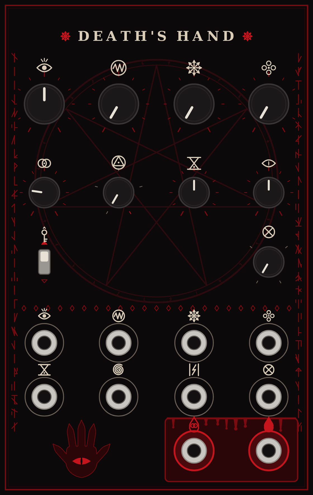

# Reading the panel

<figure class="diagram" markdown>
{ width="360" }
</figure>

There are no words on the panel, only sigils. The top row is the voice: pitch and the three character macros. Below them are the settings the patch.Init keeps on its shift layer. Each sigil repeats on the jack that modulates it, so the panel reads in columns.

| Sigil | Means |
|---|---|
| Eye (lashes) | Pitch · V/OCT input |
| Zigzag in a circle | **FLESH** macro · its CV |
| Eight-arrow star | **MALICE** macro · its CV |
| Four rings | **LEGION** macro · its CV |
| Vesica (two rings) | Ratio, or modulator pitch when free |
| Triangle in a circle | Modulator shape. The red last stop is Lorenz |
| Hourglass | Symmetry trim · its CV |
| Slit eye | Fine tune |
| Key | Ratio lock. The red arrow is up = locked |
| Crossed ring ⊗ | Routing: FM, + timbre mod, + AM, + ring · its trigger input |
| Spiral | External FM input |
| Pillars and lightning | Sync input |
| Blood drop (solid) | Primary out |
| Blood drop with rings | Modulator out |

Bone rings mark inputs, red rings mark outputs, and the outputs sit on the altar. The hand, the edge runes and the summoning circle are decoration.

## The macros

Each macro sweeps several parameters at once, each over its own stretch of the knob, so one knob (or one CV) tells one story. +/-5 V at a macro's jack sweeps its whole range, so an envelope into FLESH opens the whole voice.

| Macro | Sweeps | Along the knob |
|---|---|---|
| **FLESH** | FM index, wavefold, symmetry, modulator → timbre | FM sidebands first, then the fold opens (glassy, then snarling), then asymmetry and a moving fold |
| **MALICE** | self-feedback, chaos, extra FM | The lower half is feedback only: sine to saw, still harmonic. The edge into chaos runs from about 0.55 to 0.8. The top is possessed |
| **LEGION** | sub, voices, spread, drift | The sub arrives first, then detuned voices fade in one by one, then they drift apart |

The host tests hold each macro to its story: FLESH's brightness climbs at every step (220 Hz → 6.8 kHz centroid), MALICE stays harmonic to halfway and is fully inharmonic by 0.9, and LEGION's beating grows from 2.8× to 4.8×. The curves live in `dsp/Macros.hpp`.

## Where the panel comes from

The panel is generated: `make panel` runs `vcv/res/make_panel.py`, which writes `vcv/res/ComplexOsc.svg`, a preview with stand-in knobs and jacks, and `vcv/src/PanelLayout.hpp` from one table, so the widget positions can't drift from the artwork (CI checks this with `make panel-check`). Every sigil is drawn from code, with no fonts or images, so it renders in Rack and scales cleanly to a printed panel. It uses real Eurorack dimensions (16 HP × 128.5 mm), so it is also a starting point for a physical panel.
